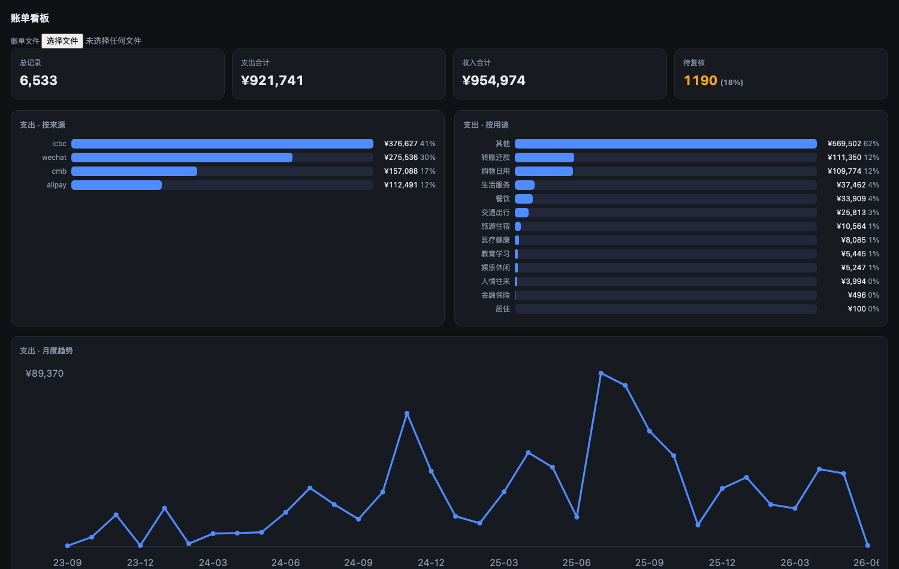

# billkit · 中文个人账单治理

把微信 / 支付宝 / 招商银行 / 工商银行 等导出的**脏账单**，清洗成**分好类、可复核、可多目标导入**的干净账本。离线、纯本地、可开源。

## 能力
- 多源账单标准化（微信/支付宝/招行/工行）
- 跨渠道去重
- 四级用途分类（交易类型映射 + 商户规则 + 同商户先验 + 待人工）
- 本地复核界面（按对手方批量打分类）+ 可视化看板
- 一键导出：木木记账模板 / Firefly III CSV / beancount 文本账本

## 目录（canonical layout）
```text
bill-review/
├── src/        核心 CLI（billkit）
├── web/        本地前端（review / dashboard，纯前端零依赖）
├── sample/     合成示例（仅此入库）
├── tests/      测试
├── scripts/    校验与编排
├── docs/       文档中心（编号分区）
├── data/       真实账单（.gitignore，绝不入库）
├── build/      生成产物（.gitignore）
└── README.md
```
目录与所有权见 [docs/PROJECT_STRUCTURE.md](docs/PROJECT_STRUCTURE.md)；全部文档入口见 [docs/README.md](docs/README.md)。

## 快速开始
```bash
pip install -r requirements.txt
python3 src/billkit.py all --input sample/ledger.sample.csv --out build/
# 复核：浏览器打开 web/review.html，选 build/classified.csv
# 看板：浏览器打开 web/dashboard.html，选 build/classified.csv
```

## 预览
看板：



复核（按对手方批量打分类）：


## 隐私
所有处理在本机进行，不联网、不上传。真实账单绝不入库：`.gitignore` 排除 `data/`、`build/`、`*.real.csv`，仓库只带 `sample/` 的合成示例。

## License
MIT
