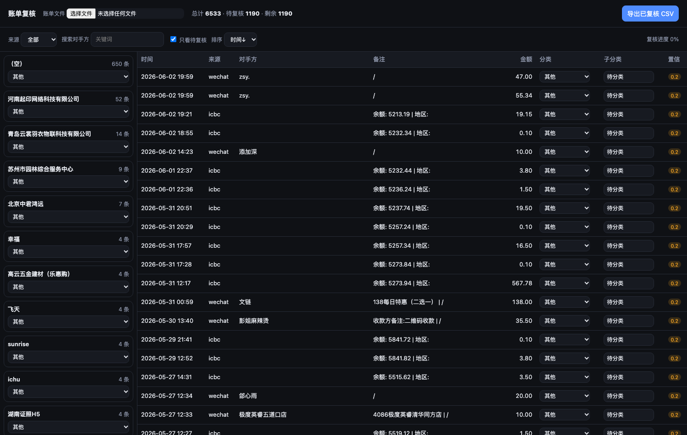

# billkit · 中文个人账单治理

把微信 / 支付宝 / 招商银行 / 工商银行 等导出的**脏账单**，清洗成**分好类、可复核、可多目标导入**的干净账本。

## 解决什么
- 多源账单格式不统一、跨渠道重复
- 记账 App 没有批量导入 / 几千条没法逐条点分类
- 微信/支付宝账单导入难

## 流程
```
原始账单.csv → 标准化 → (去重) → 用途分类(规则+先验) → 人工复核 → 导出
                                                        ├ 木木记账模板 xlsx
                                                        ├ Firefly III csv
                                                        ├ beancount 文本账本
                                                        └ 通用 csv
```

## 用法
```bash
python3 pipeline/billkit.py all --input 你的账本.csv --out build/
# 产出 build/：classified.csv / review_queue.csv / mumu_import.xlsx / beancount.bean / firefly.csv / stats.json
```
只重导出（例如复核改完 classified.csv 后）：
```bash
python3 pipeline/billkit.py export --classified build/classified.csv --out build/
```

## 复核界面 & 看板（本地、纯前端、不上传）
- `web/review.html` —— 打开后选择 `classified.csv`，按商户批量打分类、导出 `classified_corrected.csv`
- `web/dashboard.html` —— 打开后选择 `classified.csv`，看收支结构/分类占比/月度趋势

## 输入字段
见 `docs/SCHEMA.md`：`datetime, amount, type, counterparty, category, note, source, payment_method`（缺列按空处理）。

## 隐私
所有处理**在本机进行**，不联网、不上传。真实账单不要提交到仓库：`.gitignore` 已排除 `data/`、`build/`、`*.real.csv`。仓库只带 `sample/` 下的**合成示例**。

## 依赖
Python 3.9+；导出 xlsx 需要 `openpyxl`（`pip install openpyxl`）。

## License
MIT

## 预览
看板 `web/dashboard.html`：


复核 `web/review.html`（按对手方批量打分类）：


